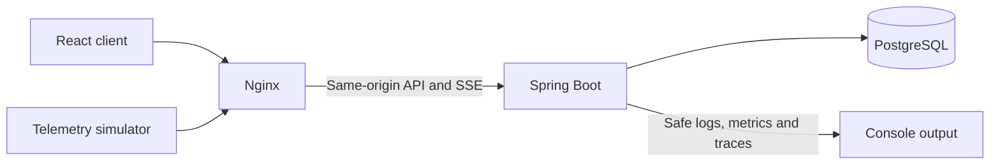

# Architecture and design decisions

AssetPulse turns synthetic temperature readings into live alerts and assigned
maintenance work. The application is a Spring Boot modular monolith backed by
PostgreSQL, with a React client and a small command-line simulator.

Local Compose runs three containers. The public hosting image runs Nginx and
Spring together; only Nginx is public and Spring listens on loopback. Hosted
PostgreSQL is external and uses verified TLS. See [local setup](SETUP.md) and
[hosting](HOSTING.md) for the concrete topology and commands.

## Boundaries and data flow

Code is grouped by feature: identity, assets, telemetry, alerts, work orders,
audit, dashboard and demo reset. Controllers handle transport, application
services own transactions, and JDBC repositories use explicit tenant-scoped SQL.
API response models are separate from persistence records.

1. Login loads a seeded identity and its organisation/role from PostgreSQL.
   Spring stores the trusted actor in a cookie-backed session. The client keeps
   its identity and CSRF token in memory.
2. An Operations Admin submits 1–100 telemetry readings with an idempotency key.
   Validation and sensor ownership checks precede an atomic write of the batch,
   readings and durable processing intent. An exact retry returns the original
   acceptance; different content under the same key conflicts.
3. A polling worker claims eligible PostgreSQL events using leases and fencing
   tokens. Processing effects and completion commit together. Bounded retries
   eventually retain a durable DEAD event for scoped administrator recovery.
4. Threshold evaluation uses a fingerprint, cooldown and database uniqueness to
   retain at most one active alert per scope. Post-commit SSE notifications tell
   clients to refresh authoritative API state.
5. An administrator acknowledges an alert, creates one work order and assigns
   an eligible technician. Only that technician can start and complete the work.
   Expected-version writes reject stale commands; history and audit commit with
   each successful transition.

PostgreSQL is the restart-safe source of truth. Composite foreign keys bind
related rows to the same organisation. History and audit are append-only through
the normal application paths and database triggers. The migration-capable
application role owns its schema; these controls do not protect against a
compromised database owner.

## Decisions and trade-offs

| Decision | Reason and consequence |
| --- | --- |
| One modular monolith | Keeps transactions and deployment inspectable for this small product. There is no service-to-service infrastructure. |
| JDBC and explicit SQL | Makes tenant predicates, conditional transitions and locking visible. Repositories own their query mappings. |
| PostgreSQL processing intent | Acceptance and pending work share one transaction. No external broker is needed; polling adds bounded delay. |
| Leased, fenced processing | Restart and concurrent claims cannot rely on process memory. Retry/dead state remains available after restart. |
| Fingerprinted alerts and cooldown | Repeated breaches update one active incident while resolved incidents can recur under the documented cooldown. |
| SSE as invalidation | Events are small and tenant/session scoped. Reconnect triggers reads; SSE is not a durable event replay log. |
| Authoritative command recovery | A lost response does not justify repeating a mutation. The UI locks commands until it reads confirmed state. |
| Single instance and server sessions | Fits the free hosting boundary. Sleep, restart and deployment invalidate process-local sessions and streams. |

## Read and browser behavior

Telemetry queries use a half-open window of at most 24 hours and return at most
500 readings in chronological order. A covering index begins with organisation
and sensor, then descending observation time and ID. Small datasets may favor a
sequential scan; [the query procedure](infra/operations/README.md) preserves the
planner's actual choice.

The TypeScript client validates server responses before publishing state. Read
failures retain previously confirmed data where appropriate. Request deadlines,
cancellation and superseded-result guards prevent late responses from changing
the current screen or session. SSE refreshes coalesce while a read is pending.
Navigation is in memory; URL routing and deep links are outside this release.

## Verification and operating limits

The backend suite uses real PostgreSQL through Testcontainers for migrations,
tenant/role boundaries, atomicity, concurrency and recovery. Component/API tests
cover client validation and failure behavior. Three Playwright journeys exercise
the live incident, isolation/role denial and two-client conflict, including
keyboard focus, desktop/mobile overflow and accessibility checks.

The [security summary](SECURITY.md) records trust boundaries and residual risks.
The [operations runbook](infra/operations/RUNBOOK.md) describes identity, smoke,
metrics, traces and compatible rollback. Dated evidence is kept under
[`infra/evidence`](infra/evidence/OCTOBER-2026.md); measurements establish only
their recorded revision and environment.

Shared synthetic accounts, free-host sleep, accumulating telemetry/audit,
process-local throttling/sessions/SSE and a single application instance are
deliberate limits. Global admission controls, retention, external identity and
multiple instances are future work. The bounded reset finishes active work and
resolves alerts; it preserves history and does not reclaim storage.
