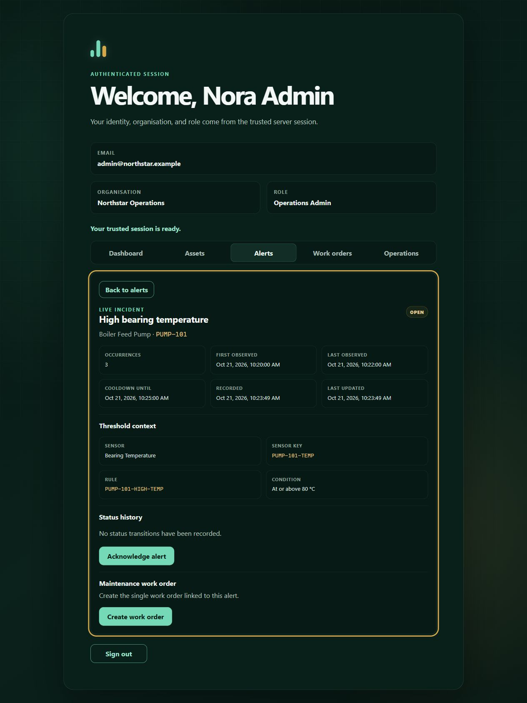

# AssetPulse

AssetPulse is a maintenance dashboard that turns sensor readings into alerts and
work orders. It follows a small but complete workflow: a pump overheats, an
administrator checks the alert, and a technician gets assigned to fix it.

I built this as a personal portfolio project to put my computer science studies
into practice. I wanted to work through a full application with Java and React,
including the parts that are easy to overlook in a demo: permissions, failed
requests, conflicting updates, testing, and deployment.

**[Try the live demo](https://assetpulse-rv4z.onrender.com)** ·
[Local setup](SETUP.md) · [Architecture](ARCHITECTURE.md)

<details>
<summary>See the live alert screen</summary>



Captured from the public demo on 21 October 2026.

</details>

## Try it out

The demo uses simulated equipment and shared accounts. The free hosting can
take a couple of minutes to wake up, so allow it some time on the first visit.
All accounts below use the password **`AssetPulse1!`**.

| Account | Role |
| --- | --- |
| `admin@northstar.example` | Operations Admin |
| `technician@northstar.example` | Technician |
| `viewer@northstar.example` | Viewer |

1. Sign in as the admin and select **Launch and open alerts** on the dashboard.
2. Open the overheating alert, acknowledge it, and create a work order.
3. Assign the work to **Theo Technician**.
4. Sign out, sign in as the technician, then start and complete the work order.

You can also sign in as `admin@riverside.example` to see a separate
organisation's data. Please keep all activity synthetic; the demo is public.

## What it does

- Shows assets, sensors, and recent temperature readings.
- Accepts telemetry batches and processes them in the background, with retries
  and recovery for failed processing.
- Updates alerts live using Server-Sent Events, with duplicate handling and a
  cooldown for repeated readings.
- Takes work orders from creation and assignment through to completion, keeping
  a history of changes.
- Separates organisations and gives admins, technicians, and viewers different
  permissions. Stale updates are rejected so one user cannot silently overwrite
  another user's work.
- Provides an audit trail and a demo reset that closes active work while keeping
  its history.

## Built with

| Part | Tools |
| --- | --- |
| Backend | Java 21, Spring Boot, Spring Security, JDBC, Flyway |
| Frontend | React 19, TypeScript, Vite |
| Database | PostgreSQL 17 |
| Delivery | Docker Compose, Nginx, GitHub Actions, Render and Neon |
| Tests | JUnit, Testcontainers, Vitest, Testing Library, Playwright and axe |

The backend is one application organised by feature. PostgreSQL stores both the
data and pending telemetry work, so the project does not need a separate message
broker. The [architecture notes](ARCHITECTURE.md) explain the main decisions and
trade-offs.

## Run locally

You need Git and Docker with Compose v2 and Linux containers enabled.

```sh
git clone https://github.com/moar0210/AssetPulse.git
cd AssetPulse
```

Follow the short [environment setup](SETUP.md#clone-and-prepare-the-environment)
to create your local `.env` with separate database passwords, then run:

```sh
docker compose up --build --wait --wait-timeout 180
```

Open [localhost:8080](http://localhost:8080) and use the same demo accounts.
The [setup guide](SETUP.md) also covers troubleshooting and stopping the stack.
An optional [Node.js simulator](simulator/USAGE.md) sends normal and overheating
scenarios through the API.

## Testing

The backend tests use a real PostgreSQL database through Testcontainers. They
cover tenant isolation, permissions, transactions, retries, and concurrent
updates. Frontend tests cover the interface and API error handling, and three
Playwright journeys check the full maintenance flow, access restrictions, and
conflicting updates, with keyboard and accessibility checks.

[GitHub Actions](https://github.com/moar0210/AssetPulse/actions/workflows/pull-request.yml)
runs the checks and container builds. See [test commands](SETUP.md#run-the-checks)
to run them yourself, or the [dated verification results](infra/evidence/OCTOBER-2026.md)
for the broader release preparation checks.

## Scope and next steps

This is a portfolio demo with shared accounts and one application instance.
Sessions end when the server restarts, and telemetry and audit history accumulate
over time. External sign-in, data retention, and support for multiple instances
would be useful next steps.

More detail is available in the [hosting guide](HOSTING.md),
[security notes](SECURITY.md), and [API contract](frontend/public/openapi.json).

AI tools provided assistance during development, testing, and documentation.

Released under the [MIT License](LICENSE).
